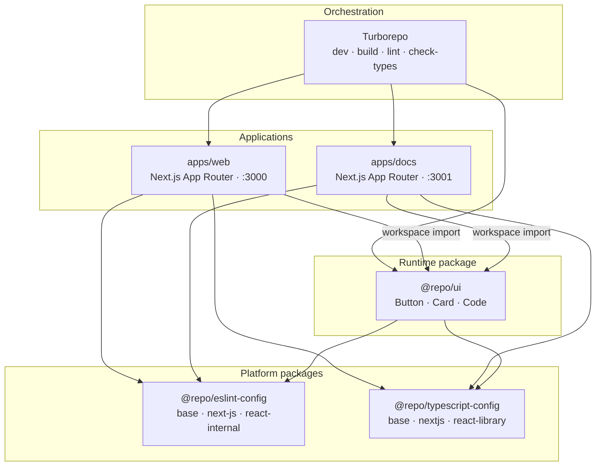

# nextjs-monorepo

Two Next.js applications share one React component library and one set of platform configs. Turborepo runs the task graph. pnpm links internal packages in place, so a change in a shared package is the change both apps compile.

## Project overview

`apps/web` and `apps/docs` are independent Next.js App Router applications. Each one runs on its own port and imports shared code through the pnpm `workspace:*` protocol. Product UI lives in `@repo/ui`. Lint rules and TypeScript bases live in `@repo/eslint-config` and `@repo/typescript-config`. Turborepo orders work so a package is ready before any app that depends on it (`build` depends on `^build`).

| Application | Workspace name | Dev port | Role |
| --- | --- | --- | --- |
| `apps/web` | `web` | [3000](http://localhost:3000) | Primary web application |
| `apps/docs` | `docs` | [3001](http://localhost:3001) | Documentation application |

## Architecture

Each application is its own Next.js process. Shared behavior arrives as a workspace import of `@repo/ui` and as shared compiler and linter config. Solid links into `@repo/ui` are source imports. Links into the config packages are `extends` relationships. Turborepo schedules `dev`, `build`, `lint`, and `check-types` across that graph.



### Repository layout

```text
nextjs-monorepo/
├── apps/
│   ├── web/                     Next.js app, port 3000
│   └── docs/                    Next.js app, port 3001
├── packages/
│   ├── ui/                      @repo/ui
│   ├── eslint-config/           @repo/eslint-config
│   └── typescript-config/       @repo/typescript-config
├── package.json                 Root scripts and pnpm overrides
├── pnpm-workspace.yaml          apps/* and packages/*
└── turbo.json                   Task graph and cache outputs
```

### How packages are shared

| Package | Consumed by | Contract |
| --- | --- | --- |
| `@repo/ui` | `web`, `docs` | `exports` map `"./*"` to `./src/*.tsx`. Apps import `@repo/ui/button`. |
| `@repo/eslint-config` | `web`, `docs`, `@repo/ui` | Apps use `./next-js`. The UI package uses `./react-internal`. |
| `@repo/typescript-config` | `web`, `docs`, `@repo/ui` | Apps extend `nextjs.json`. The UI package extends `react-library.json`. Both rest on `base.json` (`strict`, ES2022). |

## Tech stack

| Concern | Technology | Version | Where it applies |
| --- | --- | --- | --- |
| Application framework | Next.js | 16.4.3 | `apps/web`, `apps/docs` |
| UI runtime | React | 19.2 | Apps and `@repo/ui` |
| Language | TypeScript | 5.9.2 | Entire workspace, `strict` |
| Monorepo task runner | Turborepo | 2.11 | Root `dev`, `build`, `lint`, `check-types` |
| Package manager | pnpm | 9.0.0 | Workspaces via `workspace:*` |
| Runtime | Node.js | `>= 18` | Declared in `engines` |
| Linting | ESLint, typescript-eslint | 9.39 / 8.72 | Shared through `@repo/eslint-config` |
| Formatting | Prettier | 3.7 | Root `format` script |

## Quick start

Node.js 18 or newer. pnpm 9 is pinned in the root `package.json` (`packageManager`).

```bash
pnpm install && pnpm dev
```

- Web application: [http://localhost:3000](http://localhost:3000)
- Docs application: [http://localhost:3001](http://localhost:3001)

| Command | What it does |
| --- | --- |
| `pnpm dev` | Starts both Next.js dev servers |
| `pnpm build` | Production build; upstream packages build first |
| `pnpm lint` | ESLint across the workspace, zero warnings allowed |
| `pnpm check-types` | Typecheck across the workspace |
| `pnpm format` | Prettier write for `*.ts`, `*.tsx`, and `*.md` |
| `pnpm dev --filter=web` | Dev server for `web` only |
| `pnpm dev --filter=docs` | Dev server for `docs` only |
